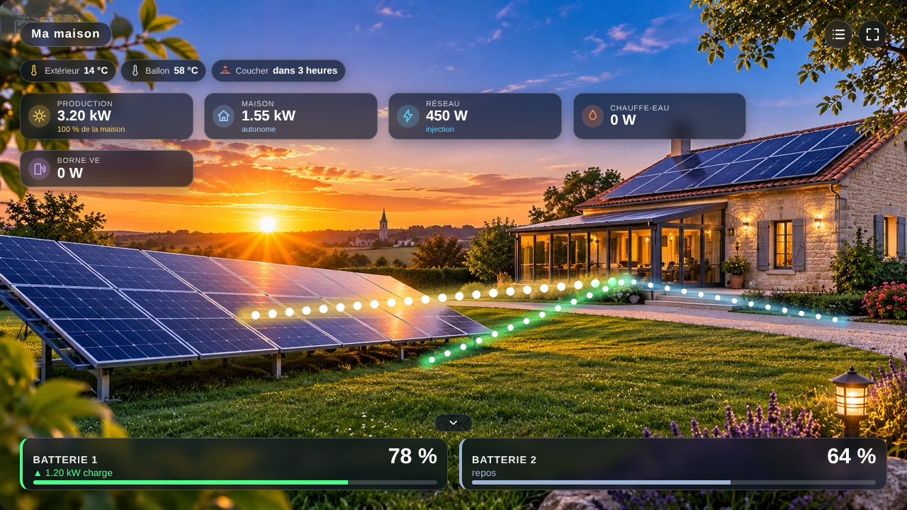
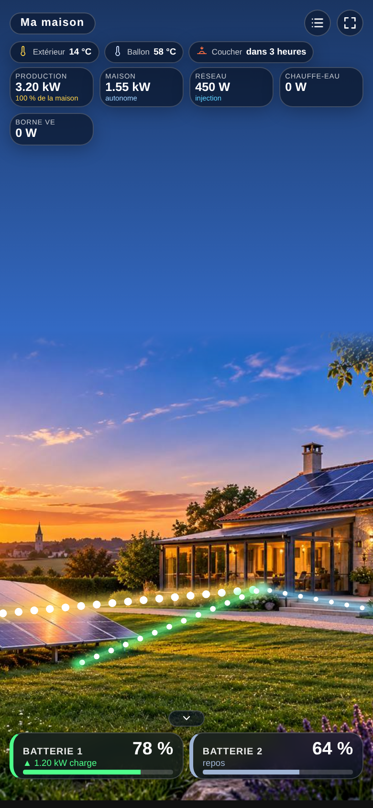
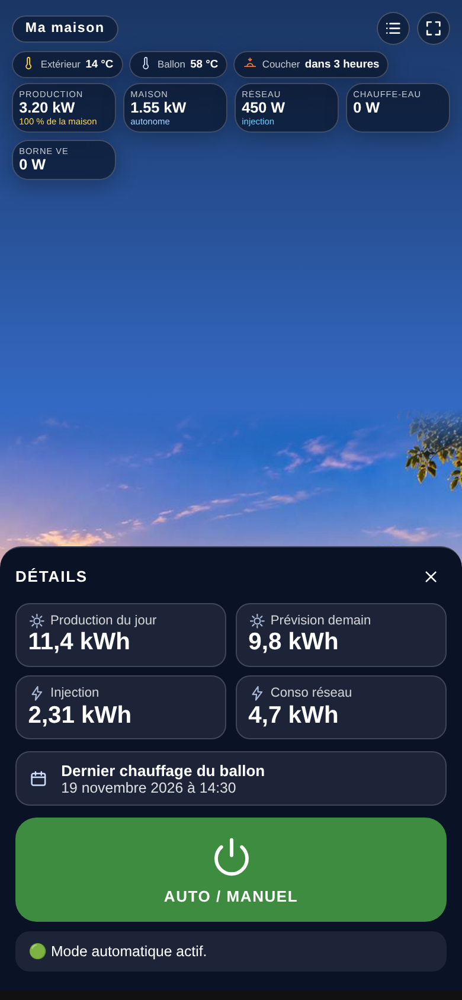

# Energy Scene Card

Une carte [Home Assistant](https://www.home-assistant.io/) qui affiche ta production solaire, ton réseau et tes batteries **sur une belle image de maison**, avec des flux animés qui changent de sens selon la situation.



<p align="center">
  
  
</p>

> *English summary:* a Lovelace card showing solar production, grid, house and batteries over a scene with animated energy flows, glass pills, one gauge per battery, a details panel, fullscreen mode and a visual editor. Works with any power sensors. Installable through HACS (custom repository).

## Fonctionnalités

- Scène réaliste (image de démo incluse, ou la tienne) avec **flux animés** : solaire → maison, réseau (import / injection), batterie (charge / décharge)
- Pastilles **production / maison / réseau**, plus autant de pastilles que tu veux (chauffe-eau, borne VE, piscine…)
- **Une tuile avec jauge par batterie** (nom, niveau, puissance)
- **Puces** pour les petites infos (températures, mode, lever / coucher du soleil…)
- **Panneau « Détails »** : valeurs, lignes, bouton interrupteur, et même d'autres cartes Lovelace
- **Plein écran**, avec passage automatique en paysage sur téléphone
- **Éditeur visuel** avec sélecteurs d'entités
- Fonctionne avec **n'importe quels capteurs de puissance**, sans dépendance

## Installation

### Avec HACS (dépôt personnalisé)

1. HACS → menu ⋮ → **Dépôts personnalisés**
2. Ajoute `https://github.com/Biwaire/energy-scene-card`, type **Tableau de bord** (Dashboard)
3. Installe **Energy Scene Card**, puis recharge la page (vide le cache de l'appli mobile si besoin)

### À la main

Copie `energy-scene-card.js` dans `/config/www/`, puis ajoute la ressource `/local/energy-scene-card.js` (type : module JavaScript) dans Paramètres → Tableaux de bord → Ressources.

## Configuration minimale

```yaml
type: custom:energy-scene-card
solar_entity: sensor.production_solaire     # W ou kW
grid_entity: sensor.puissance_reseau        # positif = import
batteries:
  - name: Batterie
    power_entity: sensor.batterie_puissance # positif = charge
    soc_entity: sensor.batterie_niveau      # %
```

Tout se règle aussi dans l'**éditeur visuel** de la carte (menu ⋮ de la carte → Modifier).
Si ton capteur réseau ou batterie a le signe inverse, utilise `grid_invert: true` / `battery_invert: true`.

Plus d'exemples dans [`examples/`](examples).

## Options

| Option | Description |
|---|---|
| `solar_entity` | Production solaire (W ou kW) |
| `grid_entity` | Puissance réseau (positif = import ; `grid_invert: true` pour inverser) |
| `house_entity` | Consommation de la maison (facultatif, sinon calculée) |
| `batteries` | Liste `{name, power_entity, soc_entity}` : une tuile par batterie |
| `battery_entity`, `battery_soc_entity` | Version simple pour une seule batterie |
| `battery_invert` | Inverse le signe de la puissance des batteries |
| `extras` | Pastilles en plus : `name`, `entity`, `icon`, `color`, `unit` (jusqu'à 6) |
| `chips` | Petites puces : `name`, `entity`, `icon`, `color`, `unit`, `decimals`, `format` |
| `chips_position` | `top` (défaut) ou `bottom` |
| `pill_size` | `small`, `medium` (défaut) ou `large` |
| `pill_opacity` | Opacité du fond des pastilles et puces, de `0` (totalement transparent, sans flou ni cadre appuyé) à `0.95` (opaque) ; défaut `0.42` |
| `text_color` | Couleur de l'écriture (pastilles, puces, batteries, titre), ex. `"#ffe9a8"` ou `white` ; défaut blanc |
| `bottom_cards_opacity` | Rend le fond des cartes du bas (`bottom_cards`) transparent : de `0` (transparent) à `1` (opaque) ; vide = cartes inchangées. Ne fonctionne que pour les cartes qui suivent le thème Home Assistant (couleurs `--card-background-color`, `--primary-text-color`) |
| `bottom_cards_display` | `inline` (défaut) : cartes affichées en bas ; `drawer` : les tuiles batteries restent en bas et une flèche ouvre un menu contenant les cartes |
| `bottom_cards_title` | Titre du menu en mode `drawer` (défaut « Batteries ») |
| `details` | Panneau Détails : `title`, `stats`, `lines`, `toggle`, `cards` (voir ci-dessous) |
| `bottom_cards` | Cartes Lovelace affichées en bas, à la place des tuiles batteries (jusqu'à 4) |
| `bottom_cards_narrow` | Sur téléphone : `side` (défaut, cartes côte à côte réduites), `swipe` (carrousel à faire glisser) ou `stack` (l'une sous l'autre) |
| `bottom_cards_width` | Largeur (px) à laquelle les cartes sont dessinées avant réduction en mode `side` (défaut 320 ; plus petit = texte plus gros) |
| `title` | Titre affiché en haut à gauche |
| `background` | URL d'une image de fond (sinon image de démo) |
| `fullscreen` | La scène remplit la vue |
| `fullscreen_button` | Bouton plein écran (défaut `true`) |
| `landscape_fullscreen` | Plein écran automatique en paysage sur téléphone |
| `points` | Positions des flux sur l'image, en % : `solar`, `house`, `grid`, `battery` (`[x, y]`) |
| `flow_curve` | Courbure des flux : `0` = lignes droites (défaut), ex. `60` pour les arrondir |
| `fit`, `zoom`, `anchor`, `focus`, `mobile_ratio` | Réglages avancés du cadrage de l'image |

Icônes : `temperature`, `water-heater`, `ev`, `plug`, `bolt`, `sunrise`, `sunset`, `calendar`, `battery`, `chart`, `power`, `clock`, `sun`, `home`, ou n'importe quelle icône `mdi:...`.

### Le panneau Détails

```yaml
details:
  title: Détails
  stats:                                     # tuiles de valeurs
    - { name: Production du jour, entity: sensor.production_jour, icon: sun }
  lines:                                     # lignes (dates, durées…)
    - { name: Dernier cycle, entity: input_datetime.dernier_cycle, icon: calendar }
  toggle:                                    # bouton interrupteur + message
    entity: input_boolean.mode_auto
    name: Auto / Manuel
    message_on: "Mode automatique actif."
    message_off: "Mode manuel."
  cards:                                     # d'autres cartes Lovelace
    - type: custom:ma-carte
```

Les dates et horodatages sont affichés lisiblement ; les nombres prennent l'unité du capteur.

## Mise en page dynamique

La scène s'adapte à l'espace disponible : l'image est recadrée pour que la maison, les panneaux et les flux restent visibles entre le haut (puces, pastilles) et le bas (batteries / cartes). Sur téléphone en paysage, les pastilles et puces se compactent sur une ligne. Le bas (`bottom_cards`, tuiles batteries) reste toujours visible. Option : `bottom_fold: true` ajoute une petite flèche pour le replier, et le replie automatiquement s'il prend trop de place.

## Utiliser sa propre image

Mets ton image dans `/config/www/` puis :

```yaml
background: /local/ma-maison.jpg
```

## Dépannage

- **La carte n'apparaît pas** : vérifie que la ressource est bien chargée (F12 → console) et vide le cache.
- **Les flux vont dans le mauvais sens** : essaie `grid_invert` et `battery_invert`.
- **L'éditeur visuel ne reconnaît pas mes listes** : elles se règlent dans l'éditeur ; les réglages avancés restent en YAML.

## Crédits

L'image de démo a été **générée par IA** (ChatGPT). Projet non officiel, sans lien avec une marque ou un fabricant. Licence MIT.
